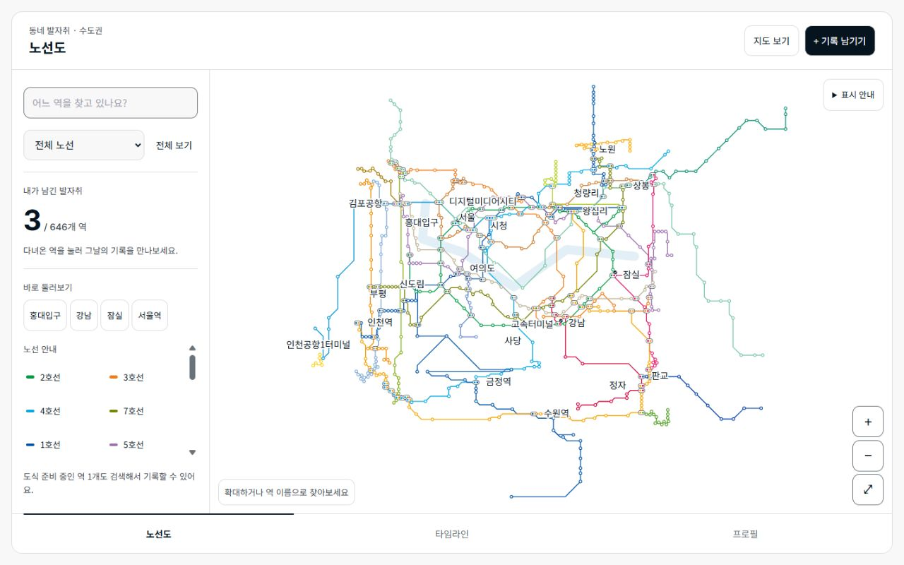

# 노선도 메인 화면 — 1차 구현 현황

작성일: 2026-10-06  
제품 결정: **노선도가 프로젝트의 메인이다. 노선도를 먼저 개선한다.**  
기준: [첨부 이미지 기반 설계](../specs/15-reference-style-line-map.md), [외부 사례 조사](line-map-reference-research-2026-10-06.md)

## 적용한 변경

| 영역 | 적용 내용 | 관련 백로그 |
|---|---|---|
| 메인 화면 | 첫 화면 노선도 유지. 넓은 화면은 최대 1440px, 900px 이상은 탐색 패널과 지도 분리. 모바일은 검색·필터 아래 남은 공간을 지도에 할당 | F02, M04, M08 |
| 읽을 수 있는 역명 | 화면 배율 1부터 일반 역명, 전체 보기 주요 역명. 역명은 13 CSS px를 유지하고 충돌에 따라 위치/노출 조절. 검색·선택 역 우선 | M01, M04 |
| 확대·선택 | 화면 크기에서 계산한 최대 줌으로 실제 배율 3에 도달. 22px 안에 여러 후보가 있으면 확대, 최대 확대 근처에서는 후보 선택. 드래그·핀치·취소를 탭과 구분 | M01, M05 |
| 검색·복원 | 이름·공백·초성·혼합 입력·‘서울역’ 접미사 검색. 기록 보기와 노선도에서 보기 분리. 검색 역 확대 시 필터 해제. 상세 복귀 시 같은 도식 버전/필터의 위치 복원 | M03 |
| 환승 | 경로 전체에서 소속 노선 집합 계산. 어느 소속 노선으로 필터해도 강조. 노선색을 여러 점으로 담은 연결 심볼 사용 | M02 |
| 방문 상태 | 노선색과 별도 체크 표시. 상세 배율에서 횟수, 100회 이상 `99+`. 로딩·실패는 `null`로 유지하고 ‘미확인’ 안내 | M06, M07 |
| 도식 구조 | 646역·33개 노선 항목을 유지하면서 분기·순환을 38개 경로로 분리. 역과 꺾임점 분리. 도심 상대 확대·외곽 압축·심볼 간격 조정, 한강 단서 추가 | M04, M05 |
| 유지보수 | 제작 원본과 산출물 분리. 같은 입력에서 동일 JSON 재생성. v2 검증기, 분기 회귀·검색·라벨·줌 테스트 추가. 기존 초기 시드가 v2를 덮지 못하도록 보호 | E02, LM-02 |

방문 집계의 권한·DB 계약은 변경하지 않았다. 이 작업은 개인 소유권 전환 완료를 뜻하지 않는다.

## 연결 관계 보정 범위

- 2호선 성수·신정지선에 성수·신도림·까치산 접점 연결.
- 1호선 광명·서동탄 지선 분리, 경인선 구로 접점 연결. 광명→관악, 서동탄→세마 허위 직결 제거.
- 5호선 강동 분기와 하남/마천 경로 분리, 마곡·발산 순서 보정.
- 6호선 응암 순환을 본선과 분리하고 폐곡선으로 표시.
- 경의중앙선 용산~청량리 운행 표시와 가좌~서울 지선 분리.
- 4호선 이촌·신용산 순서, 남태령·불암산·동구릉·수원 접점, 의정부경전철 순서 보정.

기존 `station_lines.seq`와 지리상 가까운 순서만으로 분기 연결을 확정하지 않는다. 회귀 테스트는 위 대표 구간을 검사한다. 모든 운행 계통·급행·최신 개통을 검증했다는 뜻은 아니다. 경로 탐색·요금 안내 용도로 사용하지 않는다.

## 제작·검증 방법

제작 원본은 `scripts/line-map/metro-seoul-source.json`이다. 기존 자체 도식의 역 코드·이름·좌표를 보존한다. `scripts/build-line-map.mjs`에서 분기 경로와 배치 변환을 적용해 `src/data/line-map/metro-seoul.json`을 만든다. 선 꼭짓점을 직접 덮어쓰는 대신 제작 원본·변환/보정 규칙을 수정한다.

구 초기 배치가 2호선 안쪽 역을 바깥으로 밀어낸 문제도 보정했다. 제작 원본에 공개 역 마스터의 위경도를 보관하고, 2호선 내부 역을 순환부에 투영한 뒤 가까운 순환역의 도식 변위를 보간한다. 서울·명동·동작 등 도심 역의 공간 관계를 되돌리기 위한 배치 보정이며 열차 연결 추정에는 사용하지 않는다. 앱의 역 위치는 여전히 정적 도식 좌표다.

```sh
npm run line-map:build   # DB 접속 없이 재생성
npm run line-map:check   # 재현성 + 로컬 v2 계약
npm run test:line-map    # 순수 계산·연결 회귀 8개
npm run verify:line-map  # .env.local 필요, 운영 공개 역/노선 마스터 읽기 전용
npm run build
npm run lint
```

로컬 검증은 고유 경로 ID·역 코드·유한 좌표·8방향 선분·역 순서와 꺾임점의 대응·순환 폐합·고립 역을 검사한다. DB 검증은 코드 존재와 표시 범위 누락을 검사한다. `lineCode` 중복은 분기 때문에 허용한다.

구 `line-map:seed`는 v1 초기 배치용이다. v2 입력을 받으면 실패하며 `line-map:build`를 안내한다. 신규 역은 제작 원본에 추가하고 연결·배치·라벨을 검토한다. 이름 기반 보정의 모호성을 막기 위해 제작 원본의 동명역을 감지하면 빌드를 중단한다. 동명역이 추가될 때는 해당 경로를 코드 기반으로 저작하도록 확장한다.

## 확인 결과

| 검사 | 결과 |
|---|---|
| 프로덕션 빌드 | 통과. JS 번들 500kB 초과 경고는 남음 |
| lint | 오류 0, 기존 경고 5. 이번 노선도 파일에서 새 경고 없음 |
| 노선도 단위·회귀 | 8개 통과 |
| 정적 재생성·v2 정합성 | 통과: 646역 / 38경로 / 33노선 항목 / 3063×2667 |
| 운영 공개 마스터 | 코드 존재 검사 통과. 도식 미보유 MVP 역 6개 경고 |
| 360×640, 390×844, 480×800 | 가로 넘침 없음. 검색·확대·하단 탭 표시 확인 |
| 1280×800 | 넓은 프레임·탐색 패널·중앙부 도식 배치 확인 |
| 초성 검색→지도에서 보기 | `ㅎㄷ`→홍대입구, 해당 역 자동 확대 및 읽을 수 있는 역명 확인 |
| 도식 미보유 역 검색 | 연천역에 ‘도식 준비 중 · 기록 보기’ 제공. 잘못된 지도 위치로 이동하는 버튼 없음 |
| 역 클릭→기록→복귀 | 같은 transform 복원 확인 |
| 환승 필터 | 공항철도 선택 후 홍대입구가 흐려지지 않음 확인 |
| 키보드 | 시청에서 방향키로 을지로입구 이동, SVG 탭 진입점 1개 확인 |
| 방문 조회 실패 | 상단 재시도와 개별 역의 ‘방문 정보 미확인’ 확인 |

브라우저 검증은 `tests/line-map/index.html`에서 **실제 제품 렌더러·전체 도식 + 공개 역명·가상 방문 데이터**를 사용했다. 실제 로그인·사용자 기록 저장·핀치가 가능한 모바일 기기 테스트·60fps/2.5초 성능 측정은 하지 않았다. DB 검사도 사용자 방문 기록을 조회하거나 수정하지 않았다.

### 구현 화면

아래는 가상 방문 데이터(방문 역 3개)로 검증한 데스크톱 화면이다. ‘도식 준비 중 1개’는 테스트용 미표시 역 사례이며 운영 마스터의 누락 6개와 구별한다.



[390px 모바일 확인 화면](references/line-map-implemented-mobile-2026-10-06.jpg)

## 다음 작업 우선순위

> **사용자 후속 결정:** 현재 노선도 방향으로 진행한다. 아래 미완료 항목은 별도 노선도 백로그로 보존하고, 다음 코드 개발은 [후속 개발 실행 계획](../DEVELOPMENT-ROADMAP-2026-10-06.md)에 따라 저장 신뢰성부터 시작한다. 현재 방향 승인과 아래 세부 항목의 구현 완료는 구분한다.

| 우선순위 | 항목 | 완료 기준 |
|---|---|---|
| **P0 — 노선도 후속 1순위** | 중앙부 도식 수작업 저작 | 서울역·종로·왕십리·고속터미널 등 밀집부의 꺾임·교차를 정리하고 평행 노선을 일정 간격으로 분리. 전체 보기와 상세 보기 모두 레퍼런스에 맞춰 육안 승인 |
| **P0** | 물리 환승역 별칭 정리 | 이수/총신대입구, 이촌/이촌역처럼 다른 마스터 코드로 남은 항목을 점검. 기록 연결 보존 정책을 정한 뒤 표시 그룹·검색 결과·상세 목적지를 일관되게 연결 |
| **P1** | 표시 범위의 6개 누락 역 | 성환역·직산역·두정역·청산역·전곡역·연천역의 연결·좌표·라벨 추가. 추가 전에도 검색에서 기록 접근 가능 |
| **P1** | 종점 배지·노선 번호·공유 구간 | 종점/도중 노선 번호 배치, 같은 구간의 복수 노선 색 분리. 번호·역명·방문 장식 간 충돌 방지 |
| **P1** | 정밀 라벨/접근성·실기기 검증 | 긴 역명·환승별 심볼 폭까지 충돌 계산, 색각 조건·다크 모드 육안 검토, 실제 터치 핀치/취소/후보 선택, 성능 측정 |
| **P2** | 큰 글씨·고대비·내보내기 | 별도 표시 모드와 PNG/SVG/PDF용 조판. 전체 도식 내보내기를 화면 캡처와 구분 |

**첨부 이미지 수준의 최종 도식이 완성된 상태는 아니다.** 이번 구현은 가독성·탐색·화면 공간·분기/데이터 구조를 먼저 개선한 단계다. 자동 압축과 8방향 연결만으로 남은 밀집부 시각 품질을 완료 처리하지 않는다.
