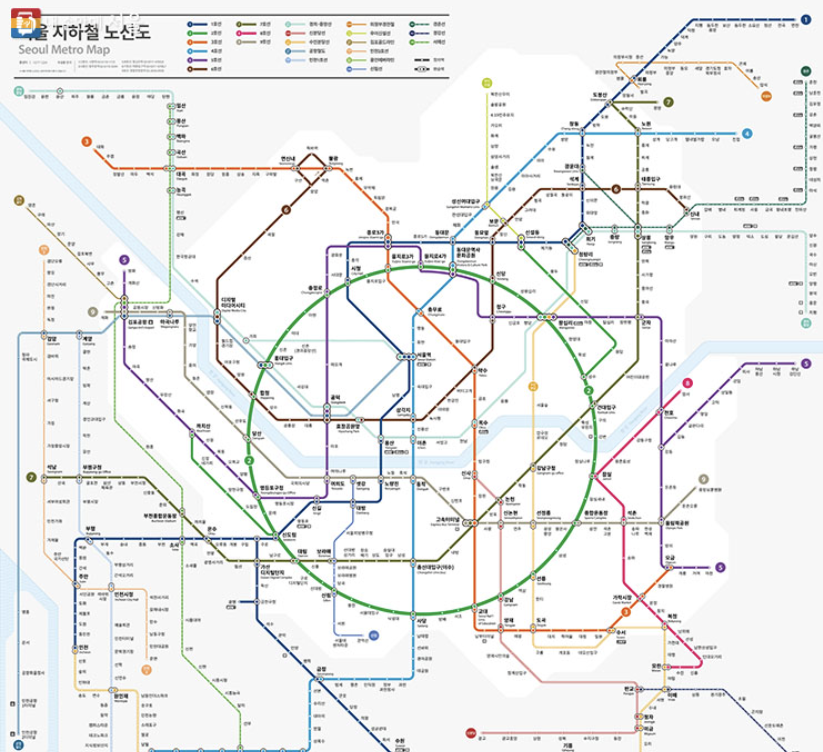

# 노선도 표현 방식 조사와 참고 자료

조사일: 2026-10-06  
목적: 사용자가 첨부한 서울 지하철 노선도와 유사한 화면을 만드는 방법을 비교한다.  
연결 문서: [노선도 개선 설계](../specs/15-reference-style-line-map.md), [개선 백로그](../IMPROVEMENT-BACKLOG-2026-10-06.md)

## 1. 결론

**첨부 이미지처럼 보이는 노선도는 구현 가능하다. 현재 React/SVG 렌더러를 유지하면서, 도식의 배치·환승 심볼·라벨 데이터를 다시 설계하는 방식을 권장한다.** 단순한 45도 스냅이나 색상 변경만으로는 첨부 이미지의 밀도와 가독성이 나오지 않는다.

외부 원본을 활용하는 경로도 있다. 서울 열린데이터광장에는 국문 노선도 PDF·JPG와 공공누리 1유형 표시가 확인된다. 먼저 해당 PDF의 벡터 구조·최신성·역 식별 가능성을 확인하면 직접 저작할 양을 줄일 수 있다. **파일 목록의 PDF 제공과, 앱에서 바로 쓸 수 있는 역 ID 포함 SVG 제공은 서로 다른 사실**이다. 후자는 이번 조사에서 확인되지 않았다. [공식 데이터셋](https://data.seoul.go.kr/dataList/OA-22535/F/1/datasetView.do)

조사는 공식 사이트·도움말·공식 발표를 기준으로 했다. 카카오맵과 네이버 지도는 공식 문서에 실린 화면을 브라우저에서 직접 확인했다. 앱을 설치해 최신 버전의 모든 동작을 시험하거나 외부 앱의 내부 렌더링 기술을 분석한 결과는 아니다.

## 2. 첨부 이미지에서 가져올 요소

원본은 사용자 첨부 이미지다. 문서 안에서 비교할 수 있도록 변경 없이 보관했다. 발행기관·제작일·이용허락은 확인되지 않았으며, 앱 배포용 원본이나 최신 역 목록으로 사용하지 않는다. 아래 내용은 이미지에서 관찰한 시각 요소다.

| 요소 | 관찰한 표현 | 우리 화면에 적용할 방향 |
|---|---|---|
| 전체 구성 | 밝은 바탕에 수도권 노선이 하나의 연결된 도식으로 보임 | 기본 전체 보기에서 전체 윤곽을 유지하고, 상세 탐색을 확대·검색으로 연결 |
| 선 모양 | 수평·수직·45도 대각선 중심, 정돈된 꺾임 | 역 사이에 꺾임점을 허용하고 평행 구간의 간격을 일관되게 저작 |
| 중심과 외곽 | 2호선 순환부가 크게 자리 잡고 외곽 노선은 주변으로 펼쳐짐 | 실제 거리 비율보다 도심 역·라벨 공간을 우선 확보 |
| 환승역 | 여러 노선색이 모인 길쭉한 연결 심볼 | 노선별 작은 표시와 하나의 물리 역 선택 영역을 연결 |
| 역명 | 선 옆 빈 공간에 배치, 구간별 방향과 줄바꿈이 다름 | 역별 라벨 위치·줄바꿈·우선순위를 지정 |
| 지리 단서 | 연한 한강·지형 배경 | 정확한 위경도 지도와 구별되는 장식 레이어로 제공 |
| 노선 식별 | 노선색, 끝점의 번호 배지, 상단 범례 | 색과 이름/번호를 함께 제공하고 모바일 범례는 접을 수 있게 구성 |

전체 수도권을 390px 화면에 넣으면서 모든 역명을 동시에 읽게 하는 것은 목표로 삼지 않는다. **전체 윤곽을 보는 화면과 역명을 읽는 확대 화면의 표현을 구분**해야 이미지의 분위기와 모바일 사용성을 함께 확보할 수 있다.

## 3. 다른 앱·웹의 표현 방식

아래의 ‘적용 제안’은 관찰에서 도출한 우리 제품의 설계 판단이다. 외부 서비스가 우리와 같은 기술을 사용한다는 뜻은 아니다.

| 사례 / 확인 방식 | 확인한 표현·동작 | 적용 제안 | 참고 범위 |
|---|---|---|---|
| **서울시 노선도 최종 디자인** / 공식 발표 | 8방향 선형, 신호등 방식 환승 표시, 지리 정보, 구분 가능한 색상·패턴을 설계 요소로 설명 | 첨부 이미지와 가까운 시각 규칙의 기준으로 사용. 환승 연결·강·종점 배지를 함께 설계 | 2023-12-26 발표, 2024-04-02 수정 자료. 2026년 운행망의 정본으로 사용하지 않음. [발표와 큰 이미지](https://mediahub.seoul.go.kr/archives/2009879) |
| **카카오맵 PC** / 공식 발표·전후 화면 직접 확인 | 넓은 노선도와 왼쪽 정보 영역. 발표는 주요 역 강조, 앱·PC의 도식 통일, 확대 시 글자·선의 선명도, 8단계 줌과 슬라이더 개선을 설명 | 데스크톱 지도 폭 확대, 전체/상세에서 일관된 도식, 선명한 벡터 표현. ‘8단계’는 우리 코드의 ‘최대 8배’ 근거가 아님 | 2024-07-02 개선 사례. 현재 앱 내부 구현 방식은 확인하지 않음. [공식 개선 안내·비교 이미지](https://kakaomap.tistory.com/399) |
| **네이버 지도 모바일** / 공식 도움말·노선도 화면 직접 확인 | 상단 역 검색, 권역 선택, 색상·번호를 갖춘 노선 선택. 화면에는 굵은 노선, 둥근 꺾임, 길쭉한 환승 심볼, 확대된 일부 구간이 보임. 도움말은 역 터치와 검색을 모두 안내 | 검색·노선 필터를 지도와 같은 화면에 두고, 환승역은 일반역과 형태로 구분. 참고 화면의 둥근 선은 선택지이며 첨부 이미지의 각진 도식을 우선 | 공식 도움말 화면 기준. 출발·도착/요금/시간 기능은 기록 앱의 필수 범위로 가져오지 않음. [지하철 이용 방법](https://help.naver.com/service/5637/contents/8290?lang=ko&osType=MOBILE) |
| **Tokyo Metro 웹** / 공식 노선도·역 번호 안내 | PDF 전체 노선도 제공. 역 번호는 노선 문자+역 번호이며 노선색 원으로 둘러쌈 | 색에만 의존하지 않는 번호·이름 표기와 범례. 수도권 역에 임의의 도쿄식 코드를 새로 붙이지는 않음 | 공식 설명 확인. [Subway Map](https://www.tokyometro.jp/en/subwaymap/index.html) |
| **TfL 웹** / 공식 접근성 안내 | 큰 글씨 컬러 지도, 큰 글씨 흑백 지도, 무단차 이동 안내 지도 등을 목적별로 제공 | 읽기 쉬운 확대·검색 목록을 기본 확보하고, 큰 글씨/고대비 보기와 인쇄용 출력은 후순위 확장 | 공식 제공 목록 확인. PDF의 전체 시각 검수나 실사용 테스트는 수행하지 않음. [Accessibility guides and maps](https://tfl.gov.uk/transport-accessibility/download-accessibility-guides-and-maps) |

직접 확인한 네이버 도움말 화면: [노선도·검색·권역 선택 예시 이미지](https://naver-help-phinf.pstatic.net/MjAyNDEwMTVfMTQ0/MDAxNzI4OTcxOTc2ODc4.-2kDtvjy7t8OKJ_COlhREA-f-NgaUPKL_E7KzpJGRYYg.kL8gFRKq7P6F31iicGPPhjS4drnTz4P5IHEyaE-b0LAg.PNG/11.png?type=w1000). 외부 화면은 참고 링크로 제공하며 서비스 자산으로 복사하지 않았다.

## 4. 실제로 구할 수 있는 원본과 사용 범위

### 4.1 우선 검토할 공식 자료

[서울교통공사 수도권 지하철 노선도 4종 데이터셋](https://data.seoul.go.kr/dataList/OA-22535/F/1/datasetView.do)의 파일 목록에는 다음이 표시된다.

- `지하철_국문노선도_20250929.pdf`: 3.9MB, 파일 수정일 2025-09-29.
- `지하철_국문노선도_20250929.jpg`: 6.46MB, 파일 수정일 2025-09-29.
- 영어·중국어·일본어 PDF/JPG도 제공.
- 이용허락 표시: **공공누리 1유형, 출처표시 조건으로 상업적 이용 및 변경 가능**.
- 메타정보 수정일 2026-04-22와 파일 수정일, 별도의 데이터 갱신일은 서로 다르게 표시된다. 메타정보 수정일을 노선 최신 기준일로 쓰지 않는다.

이는 제공 목록·표시 조건을 확인한 결과다. 국문 PDF를 내려받아 벡터 경로·텍스트·레이어 구조를 검사하거나 현재 646개 역과 매핑한 작업은 아직 하지 않았다. 실제 채택 파일의 출처·조건·기준일을 함께 기록하고, 최신 역 마스터와 차이를 검토해야 한다.

같은 서울시 자료라도 조건이 같지 않다. [서울지하철 현황 및 이용안내](https://news.seoul.go.kr/traffic/archives/1551)는 페이지 하단에 **공공누리 4유형(출처표시·상업적 이용금지·변경금지)**을 표시한다. 위 데이터셋의 1유형 조건을 다른 페이지의 이미지나 사용자 첨부 이미지에 확대 적용하지 않는다.

### 4.2 원본 활용 절차

1. 실제 사용할 파일명·다운로드 위치·기준일·이용허락 표시를 고정한다.
2. PDF가 벡터이면 선·텍스트·환승 심볼을 분리할 수 있는지 검사한다. PDF라는 확장자만으로 편집 가능한 벡터라고 가정하지 않는다.
3. 분리 가능한 원본은 제작 도구에서 정리하고 `stationCode`를 별도로 매핑한다. 텍스트가 윤곽선으로 변환됐거나 ID가 없어도 자동 역 매핑이 완료됐다고 보지 않는다.
4. 래스터 이미지만 활용 가능한 경우에는 이미지 배경+좌표 오버레이 시범안 또는 자체 벡터 저작 중 하나를 선택한다. 첨부된 저해상도 캡처를 서비스 바탕으로 확대하지 않는다.
5. 앱의 출처 화면과 향후 내보낸 이미지에도 채택 원본의 출처를 유지한다. 제품 배포 시 사용할 표시 문구는 실제 채택 자료를 기준으로 작성한다.

## 5. 구현 방법 비교

비용은 상대 비교이며 일정 견적이 아니다. 현재 앱에는 React/SVG 노선도와 팬·줌이 있으므로 이를 활용하는 기준이다.

| 방법 | 첨부 이미지와의 유사도 | 방문 표시·검색·노선 필터 | 작업/유지보수 | 판단 |
|---|---|---|---|---|
| **A. 공식 고해상도 이미지 + 역 좌표 오버레이** | 원본 자체의 모양 유지 가능 | 클릭·방문 배지 가능. 이미지에 합쳐진 개별 노선/역명을 따로 흐리거나 재배치하기 어려움 | 도입 시 배경 제작은 줄지만 역별 수동 매핑·갱신 때 재정렬 필요. 고배율 해상도와 파일 크기 관리 | 빠른 시각 시범안. 완성 앱의 기본 방식으로는 제한 큼 |
| **B. 공식 PDF의 벡터 활용 + 의미 데이터 매핑** | 적합한 벡터가 있으면 원본 형태 활용에 유리 | 선·라벨을 분리하고 코드와 매핑하면 가능 | PDF 구조 검사·경로 정리·역 매핑 필요. 구조에 따라 재저작보다 비쌀 수 있음 | **원본 적합성 우선 조사 대상**. 변환 가능 여부는 미확인 |
| **C. 자체 도식 데이터 저작 + 기존 SVG 렌더러 개선** | 배치·환승·라벨을 함께 설계하면 달성 가능 | 현재 방문 기록·필터·접근성을 가장 세밀하게 제어 | 초기 배치 비용 있음. 꺾임점·분기·라벨 보정값과 제작 원본을 버전 관리 | **기본 권장안**. B가 적합하면 C의 저작 원본으로 결합 |
| **D. LOOM 등 자동 도식 생성** | 각도 정리는 가능하나 첨부 이미지 같은 구도 보장 없음 | 결과를 변환하고 코드 매핑하면 가능 | 연결 그래프 준비, 도구 빌드, ID 대응, 라벨·밀집부 보정 필요 | 향후 초안 생성 실험. 1차 구현 필수 의존성으로 두지 않음 |
| **E. 현재 좌표에 45도 스냅·CSS만 추가** | 도심 비율·분기·라벨 구조의 제약이 남음 | 기존 기능 유지 | 작업은 작지만 레퍼런스와의 핵심 차이가 해소되지 않음 | M01 긴급 가독성 수정과 구분. 전체 재설계의 대안으로는 불충분 |

### 도구를 선택할 때의 구분

- **SVG/현재 팬·줌 유지**: 도식을 그리는 기본 수단. 정적 경로·라벨·역·방문 표시를 분리한다. 벡터 편집 도구는 제작에만 사용하고 최종 데이터는 리포지토리에서 관리한다.
- **D3 zoom**: SVG/HTML/Canvas에서 줌·팬과 범위 제한을 지원한다. 현재 제스처 구현을 개선할 필요가 있을 때만 검토한다. 서울 노선도를 자동 배치하거나 역 좌표를 공급하는 도구는 아니다. [공식 문서](https://d3js.org/d3-zoom)
- **Leaflet CRS.Simple**: 지리 좌표가 아닌 평면 좌표에서 이미지·마커를 다룰 수 있어 A의 시범안에 적합하다. 예제는 지도 단위와 이미지 픽셀의 차이, `[y, x]` 좌표 순서에 주의를 요구한다. 기존 SVG로도 오버레이가 가능하므로 도입은 필수가 아니다. [공식 예제](https://leafletjs.com/examples/crs-simple/crs-simple.html)
- **LOOM**: 공식 저장소는 GeoJSON 연결 그래프 처리, `octi` 도식 생성, `transitmap` SVG/벡터 타일 출력을 설명한다. GTFS 변환기도 있지만 **GTFS만 입력 가능한 것은 아니다**. 현재 역 관계를 올바른 그래프로 만드는 작업이 먼저다. 도구 라이선스는 GPL-3.0이며 실제 도입 범위에 맞춰 확인한다. [공식 저장소](https://github.com/ad-freiburg/loom)

Kakao/Naver 서비스에서 노선도를 보여준다는 사실만으로 개발자용 SDK가 그 노선도 자산·좌표·스타일을 제공한다고 볼 수 없다. 이번 조사에서는 재사용 가능한 해당 API를 확인하지 않았으므로 도입안의 전제로 삼지 않는다.

## 6. 채택·보류할 요소

| 구분 | 항목 |
|---|---|
| 우선 채택 | 전체 도식의 정돈된 형태, 도심 간격 확보, 노선 번호/이름, 연결된 환승 심볼, 읽을 수 있는 확대, 역 검색, 간단한 범례 |
| 우리 제품에 맞게 변형 | 교통 안내 중심 선택 UI를 방문 기록 조회·작성으로 연결. 방문 표시는 노선색·환승 연결을 가리지 않는 별도 장식으로 추가 |
| 축소·대체 | 읽히지 않는 전체 역명 일괄 노출, 미세한 채움 농도에만 의존한 횟수 전달, 모바일에 큰 범례 상시 표시, 대표 노선 하나로 환승 필터 판정 |
| 후순위 | 큰 글씨 보기, 고대비 보기, 현재 영역/전체 노선도 PNG·SVG·PDF 출력. 전체 출력은 화면 캡처와 별도 조판 필요 |
| 이번 범위 밖 | 최단 경로, 요금·시간표·실시간 도착, 혼잡도, 전국 권역 확대. 지도 표현 개선을 이 기능들과 묶지 않음 |

구체적인 데이터 구조·화면 흐름·우선순위·완료 기준은 [스펙 15](../specs/15-reference-style-line-map.md)에 정리했다.

## 7. 구현 착수 후 공식 원본 검사 (2026-10-06)

[서울 열린데이터광장 원본 제공 페이지](https://data.seoul.go.kr/dataList/OA-22535/F/1/datasetView.do)의 국문 `20250929.pdf`를 내려받아 구조와 렌더링을 확인했다. 1페이지·2551.18×2551.18pt이며, 파서 기준 곡선 17,246개·선 61개·텍스트 문자 61개·래스터 이미지 0개다. 역 이름 대부분이 글자 윤곽 경로라 역명/역 코드가 붙은 SVG처럼 자동 매핑할 수 없다. 추출된 텍스트도 역 이름 정본으로 사용할 수 없었다.

따라서 방법 B는 **벡터 도형은 존재하지만 의미 데이터 매핑에 별도 작업이 필요**한 상태로 판정한다. 파일의 벡터 여부 미확인은 해소했으나, 역 코드가 붙은 재사용 가능 자산을 확보한 것은 아니다. 1차 구현은 방법 C를 택해 기존 자체 도식 원본·분기 보정·SVG 렌더러를 개선했다. 공식 PDF 도형·문자 윤곽은 앱 자산에 복사하지 않았다. 직접 원본을 활용하는 후속 작업에서는 해당 파일의 표시 조건과 출처 표기를 다시 확인한다.

공식 도식은 중앙 순환부의 비율, 8방향 경로, 환승 연결, 역명 배치의 비교 기준으로 사용한다. 1차 도식의 외곽 압축·자동 꺾임점 생성은 최종 수작업 레이아웃을 대신하지 않는다. [구현 현황과 남은 항목](line-map-implementation-2026-10-06.md)을 함께 참고한다.
